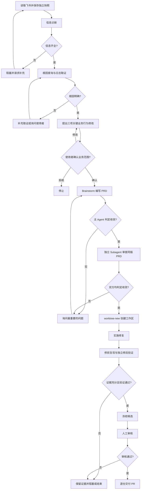

# Agent Workflow 流程

本文只定义 Agent 的阶段顺序、推进门槛、用户决策和执行产物。系统大组件关系见 [组件关系](08-组件关系.md)。

## 1. 流程参与者与职责

| 角色或组件 | 职责 | 输出 |
| --- | --- | --- |
| 使用者 | 提供工单与故障信息，补充缺失项，确认业务变更，回答 PRD 关键问题 | 补充信息、明确选择及确认记录 |
| 飞书读取适配器 | 读取工单字段和评论，保存来源与读取身份 | 独立版本快照 |
| 信息诊断 Agent | 根据规则判断取证输入是否齐全，指出缺失与冲突 | 信息诊断报告 |
| 根因查询 Agent | 按 mobi、环境、trace-id 查询日志，结合 spec 索引定位代码，确认因果关系与业务范围 | 根因证据报告与三项关键业务变更 |
| 主 Agent | 协调用户问答，通过 brainstorm 形成 PRD，并判断是否收敛 | PRD、关键问答与收敛结论 |
| 独立审查 Subagent | 审查同一版本 PRD 是否收敛，指出遗漏或冲突 | 独立审查结论 |
| 流程协调器 | 校验阶段结果、版本、确认与权限，调度执行、取消和重试 | 权威任务状态与阶段事件 |
| 工作区管理器 | 按已通过的 PRD 创建隔离 worktree，固定代码基线 | 仓库工作区与基线 SHA |
| 实施与验证 Agent | 在已确认范围内修复，通过修前复现和独立修后验证提供证据 | 修改清单、验证结果与候选树 |
| 审核人与交付器 | 审核冻结候选并按审批绑定创建逐仓 PR | 审核记录和 PR |

## 2. 阶段流程图

### 2.1 独立快照

飞书 API 结果保存为独立快照，包含工单身份、字段、描述、评论、源更新时间与读取时间。快照是事实输入，不直接转换或命名为 PRD。

每次信息补充形成可追溯版本。阶段报告引用输入版本，避免把不同时间的评论、代码和确认结果拼成未经核对的需求。

### 2.2 信息诊断

信息诊断规则集中在 [05-信息诊断 Agent 规则](05-信息诊断agent-规则.md)。诊断报告列明逐项证据、缺失项、冲突和需要用户回答的问题。

信息齐全仅允许开始根因查询，不表示根因明确、需求已确认或可以改代码。判定无法完成、规则无法匹配、必要证据无法核实时，不自动放行。

### 2.3 根因查询

根因查询 Agent 以故障 mobi、复现条件、环境与日志线索为入口，通过 SSH 到 `192.168.2.74` 查询和跟踪 Bug 日志；需要 trace-id 的请求以工单中的 trace-id 为关联依据。

Agent 根据 Trellis spec 索引确定业务模块、接口和代码入口，再将日志事实与调用链对应，解释故障表现的因果关系。报告区分已证实事实、推断与未解决疑点，不能把代码中存在可疑逻辑直接等同于本次故障根因。

此阶段允许只读查询代码和日志，不创建修改 worktree，不修改业务代码。取证不足时继续查询或向用户补充问题，不提前生成 PRD。

### 2.4 业务变更确认

根因明确后，向使用者展示最重要的三项业务行为修改。每项说明当前行为、拟变更行为、影响范围和证据，使用户能根据业务含义作出选择。

前端支持明确确认、要求修改或拒绝，并记录用户身份、选择内容和版本。真实变更不足三项时如实展示，不为凑数增加业务修改。未回答或超时不视为批准。

用户确认后的业务范围是 PRD 的输入约束。范围变化需要重新确认。

### 2.5 PRD 编写与收敛

只有根因明确、业务范围经用户确认后，主 Agent 才启动 brainstorm 编写 PRD。PRD 说明问题、根因证据、期望业务行为、变更边界和验收条件，不直接照搬快照。

不收敛时优先提出影响最大的关键问题，通过用户回答更新 PRD，直到主 Agent 判定收敛。不能把影响业务行为或验收的重要假设留给实施 Agent 自行决定。

主 Agent 通过后，启动另一个 Subagent，依据收敛规则独立审查同一版本 PRD。只有主 Agent 与独立审查 Subagent 均通过，才进入工作区准备。任何一方提出异议都回到讨论；PRD 变更后重新判定，不沿用旧版本结论。

### 2.6 工作区准备、修复与交付

双重收敛通过后，通过 worktree-new 工作区管理适配器为实际修改仓库建立隔离工作区并固定目标分支和基线 SHA。实施依据已通过 PRD；新增业务范围必须回到业务确认和 PRD 收敛。

验证应证明冻结基线存在相同业务故障、候选修复后通过相同验收条件，并排除缺依赖、网络失败等环境错误。独立验证通过后冻结逐仓 tree、目标分支及基线 SHA。

另一位成员审核绑定到冻结候选。交付前检查目标分支未移动；移动时重新验证。多仓库先生成 Draft PR，再统一协调为可审核状态，中途失败保存交付记录用于恢复，避免重复创建。

## 3. 任务状态与用户交互

任务必须区分队列状态、业务阶段、等待原因和执行进展。

| 阶段 | 必须展示的信息 | 使用者可执行的操作 |
| --- | --- | --- |
| 信息诊断 | 判定结果、缺失项及来源 | 补充信息、取消 |
| 根因查询 | 当前取证步骤、证据、疑点及最后活动时间 | 补充线索、取消 |
| 业务确认 | 三项关键行为、影响范围、确认版本 | 确认、修改、拒绝 |
| PRD 讨论 | PRD 内容、最重要问题、当前版本 | 回答、调整范围、取消 |
| 收敛复核 | 主 Agent 和独立 Subagent 的结论及异议 | 回答关键问题、查看文档 |
| 工作区准备与实施 | 仓库、基线、执行阶段、耗时 | 查看进展、取消 |
| 验证与审核 | 修前/修后证据、候选差异及冻结身份 | 审核或拒绝 |
| 失败与交付 | 具体失败阶段、原因、恢复条件或 PR 链接 | 条件满足后重试、查看产物 |

缺信息、待用户确认、执行失败和主动取消是不同状态。等待用户时停止自动推进；重试根据失败阶段及版本有效性重新校验门槛，不能跳过信息诊断或复用失效批准。

## 4. 流程产物与版本绑定

| 数据对象 | 核心内容 | 绑定关系 |
| --- | --- | --- |
| Job | 工单身份、创建人、范围、权威状态 | 关联各输入版本与执行尝试 |
| Snapshot | 飞书字段、描述、评论、时间和来源 | 信息诊断的明确输入版本 |
| 信息诊断报告 | 判定、规则、逐项证据及缺失项 | 绑定 Snapshot |
| 根因报告 | mobi、环境、trace-id、日志与代码证据、业务范围 | 绑定已通过的信息版本和取证代码版本 |
| 用户确认 | 业务选择、确认人、内容与版本 | 绑定根因报告和业务范围 |
| PRD | 收敛后的需求、边界和验收条件 | 绑定根因与用户确认 |
| 收敛审查 | 两个判断主体的结论、异议和规则 | 绑定同一 PRD 版本 |
| Attempt | 工作区、基线 SHA、阶段、起止、错误及证据 | 绑定已通过的 PRD |
| Candidate | 逐仓冻结树和验证结果 | 绑定 Attempt |
| 审批与交付 | 审核绑定、逐仓 PR 和恢复记录 | 绑定 Candidate |

前端能从同一个任务追溯快照、根因、业务选择、PRD、双重审查与修改证据。原始工单内容和模型结论分开保存，保留事实来源，不以汇总文本覆盖原始记录。

## 5. 规则与执行协议

- [信息诊断 Agent 规则](05-信息诊断agent-规则.md)定义信息齐全的判定依据。
- [任务执行协议](07-任务生命周期与执行协议.md)提供执行层专题。

业务流程以本文为准；快照不直接生成 PRD，根因、用户确认和同版 PRD 双重收敛均不可跳过。

## 6. 工作区管理适配器

部署执行器通过具名 fix/bugfix-* 分支及 git worktree 实现 worktree-new 工作区契约，保存 worktrees.json；不依赖交互式聊天宿主安装同名技能。根因阶段采集的仓库 SHA 与实施准备时的基线必须一致，发生变化时停止并重新确认，不自动沿用旧根因与 PRD。批准的 PRD 内容及哈希在实施与验证前后校验，不允许模型改写后继续验收。
