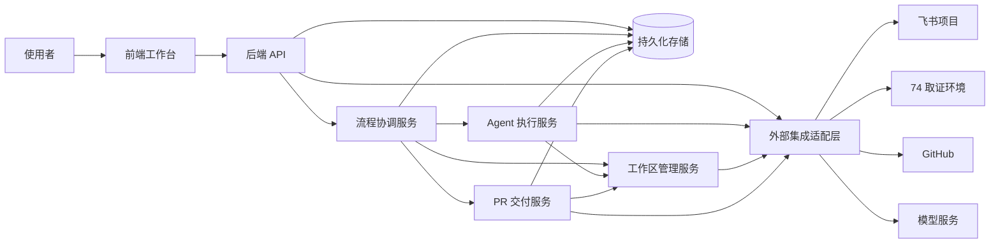

# 组件关系

## 1. 图的范围

本图只表示大组件之间的依赖与访问关系。箭头表示调用或访问，不表示时间先后、任务状态或 Agent 执行阶段。Agent 流程见 [02-agent-workflow流程](02-agent-workflow流程.md)。

## 2. 大组件关系图

持久化存储包含状态与文件产物；执行服务只能写入授权产物空间，权威状态和通过结论由协调服务校验后提交。外部集成适配层代表按能力隔离的访问边界，不代表所有调用共用凭据或网络代理。

## 3. 关系约束

| 关系 | 约束 |
| --- | --- |
| 前端 → API | 用户操作统一鉴权，客户端不直接启动执行或发布 |
| API → 协调服务 | 提交经过校验的命令，由协调服务决定是否执行 |
| 协调服务 → 执行服务 | 绑定任务、输入版本、能力范围和时限 |
| 执行服务 → 存储 | 写入可追溯产物，不覆盖权威状态与审批 |
| 执行服务 → 工作区 | 使用授权的只读分析区或隔离修改区 |
| 工作区 → 适配层 | 仓库身份、分支和网络获取受控 |
| 交付服务 → 存储/工作区 | 仅发布与有效审批一致的冻结候选 |
| 适配层 → 外部系统 | 分别管理飞书、SSH、GitHub 和模型身份 |

端口和网络代理属于部署维度，具体 Agent 阶段属于流程维度，不作为组件关系图节点展开。
